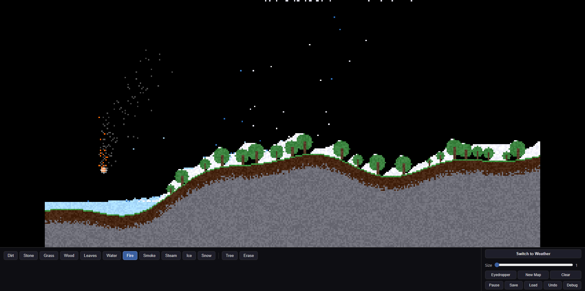

# Weather Simulator

[Play the simulator](https://weather-simulator-sepia.vercel.app/), a sandbox where you can see how weather affects the environment and how different conditions interact.

The sandbox is implemented, and future updates will continue to refine it and add sliders to control the weather.
ive also now added some weather sliders and added functionality into them, but some of them are still dead and dont have functionality yet, with new elements for week 2.

## Development roadmap

- Week 1: Rough sandbox
- Week 2: Refined sandbox
- Week 3: Add weather sliders
- Week 4: Make the sliders more interactive by adding weather intensity controls
- Week 5: Improve automatic terrain generation
- Week 6: Refine the simulator and clean up unused code

